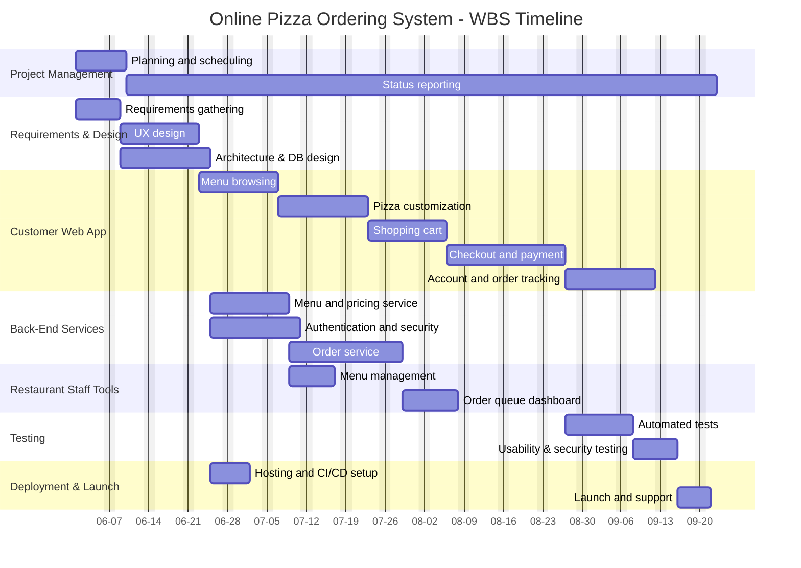

```
Here's a WBS for a Pizza Ordering System:

* Online-Pizza Ordering System (100%)
    * Project Management (10%)
        * Planning and scheduling
        * Status reporting
    * Requirements and Design (15%)
        * Requirements gathering
        * UX design
        * Architecture and database design
    * Customer Web Application (35%)
        * Menu browsing
        * Pizza customization
        * Shopping cart
        * Checkout and payment
        * Account and order tracking
    * Back-End Services (20%)
        * Menu and pricing service
        * Order service
        * Authentication and security
    * Restaurant Staff Tools (7%)
        * Order queue dashboard
        * Menu management
    * Testing (8%)
        * Automated tests
        * Usability and security testing
    * Deployment and Launch (5%)
        * Hosting and CI/CD setup
        * Launch and support
```

## Dirty Estimate
Because this project includes some pretty complex API integration, database design and various authentications and UI/UX menus, I would estimate this project would take a small team somewhere between 2 to 3 months, and thus ~4 to 6 months of time after multiplying by 2 for a dirty estimate.

## Days compute
* Online Pizza Ordering System: 4 to 6 months
    * Project Management: 12 to 18 days
    * Requirements and design: 18 to 27 days
    * Customer Web Application: 42 to 63 days
    * Back-end Services: 24 to 36 days
    * Restaurant Staff Tools: ~8 to ~13 days
    * Testing: ~10 to ~14 days
    * Deployment and Launch: 6 to 9 days

## Parallel Tasks
* Project Management runs parallel with all tasks
* Customer App and Restaurant Staff tools can be developed with eachother once the backend is complete without interfering with one another
* Testing would be done in parallel with other pre-launch development

## Gantt Chart

