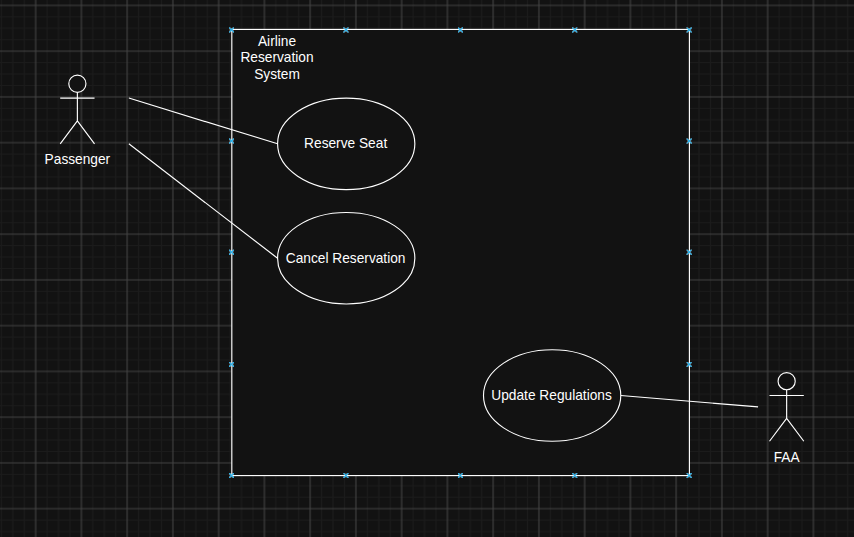

# CS 361 - Exploration 2.4: Use Case Diagrams

## Come up with two actors for an airline reservation system.

* A passenger who wants to reserve a seat
* The FAA (or equivalent organization) that can change regulations/guidelines, and thus the requirements of the system

## Come up with three use cases for the airline reservation system that those actors would use.

* The passenger reserves seats on the plane
* The FAA changes regulations for the maximum number of people allowed on a certain model of plane
* The passenger cancels a reservation flight

## Using draw.ioLinks to an external site. or another tool, draw a proper UML use case diagram for your actors and use cases.

* 