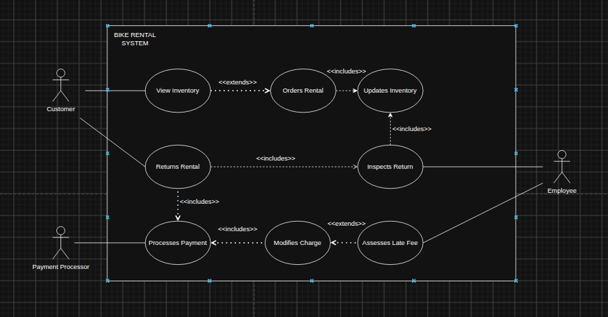

# Project 2: Functional Spec Part 1

## Overview: 
The Bend Bike shop is a store that rents bikes out to customers. They are looking to create a web-based software interface where customers can reserve bike rentals, either online (such as through a browser) or through a kiosk in the store. 

## User Scenarios
### My Scenarios:
#### Bradley: An intermediate with a daughter
* Bradley is an intermediate-level mountain biker from the local area who is looking to take his young daughter out on the trails for a weekend. To him, essential features include the ability to rent the bike uninterrupted for multiple days, as well as the ability to search the inventory for bikes based on size (his daughter is quite small). In order to get the best fit, he goes in person. He selects a bike for his daughter, swipes his card at the kiosk, and is presented with a clear confirmation that his card is approved and will not be charged until return.
#### Sarah: A technologically illiterate employee
* Sarah is an employee at the Bend Bike shop. After a rental, a customer comes to return a bike 30 minutes past the scheduled return window. The customer calls in advance, so she has to manually reduce the late fee through the interface. As someone who has little experience with technology, she highly values an easy-to-navigate UI where essential information is easy to access to prevent frustration. After hanging up, she opens the interface, is clearly presented with a notice of the late bike, and adjusts the fee.
### LLM Scenarios (modified by me):
#### Olivia (An adult customer planning a family weekend trip)

* Goal: Reserve and pre-pay for specific family bikes online prior to arriving in town.

* Action: Two weeks before her trip, Olivia opens the Big Bend Bike Shop website on her home laptop. She enters her rental dates and filters the available inventory search for a performance road bike for herself, a comfortable recreational bike for her husband, and two children’s bikes.

* Selection & Checkout: After selecting four bikes that match her family's needs, she proceeds to the checkout screen, enters her contact details, and provides her credit card information to secure the reservation. The system validates the card without charging it immediately.

* Modification: Three days before the trip, weather forecasts predict rain. Olivia logs back into her account online and changes her rental start time by two hours. Because she modified the reservation well outside the 24-hour cutoff window, no change penalty fee is applied.

* Return & Payment: After enjoying the bikes, Olivia returns them to the store on time. A store employee inspects the bikes, marks them as returned in the system, and confirms there are no damages. The system calculates the final balance based on the actual duration and automatically charges Olivia's credit card. 
#### Sarah, General Manager at Big Bend Bike Shop

* Goal: Update bike rental rates ahead of an upcoming holiday weekend

* Action: Sarah logs into the admin portal of the web-based system and navigates to the Rate Management settings. She updates the daily rates by bike category—increasing high-performance road bikes and recreational cruisers for the 3-day weekend block—and saves the changes. The updated rates immediately reflect across both the online reservation website and the in-store kiosks for future bookings.
## Non-Goals
* The system does *not* include functionality for purchasing a bike or gear. Rentals only
* The system should *not* include advertisements within the app, or outside of the app (as that is outside of our parameters)
* The system does not need to include automatic discount systems
* The system will not require automated blacklisting of individuals. That process is manual
* Automated cancellation of future rentals due to limited stock is *not* necessary at least according to the client

## Use Case Diagrams
