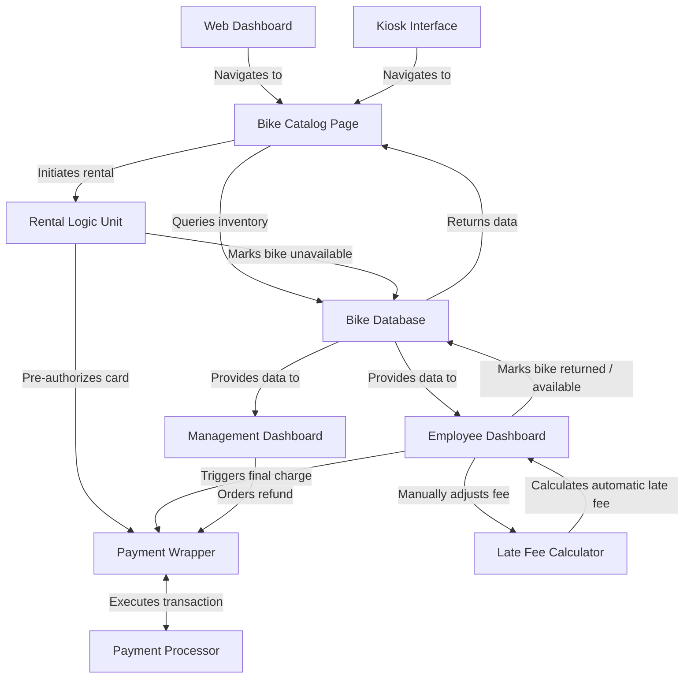

# Design Doc
## Overview
The Bend Bike shop is a store that rents bikes out to customers. They are looking to create a web-based software interface where customers can reserve bike rentals, either online (such as through a browser) or through a kiosk in the store. 

## Actors
* Customer
    * Opens inventory
    * Selects bike
    * Rents bike
    * Enters card information
    * (If on kiosk) Swipes card
* Employee
    * Opens inventory
    * Selects bike
    * Marks as returned
    * Adjusts late fees
    * Handles cash payments
* Management
    * Approves/declines refunds
    * Views summary reports
* Payment Processor (external)
    * Verifies card information
    * Conducts authorization charge
    * Charges credit or debit card
    * Approves/declines transactions

## Goals/Non-Goals
### Goals
* Display available bike inventory
* Allow bikes to be rented by customers, marking them as unavailable/occupied in a database
* Allow bikes to be added, removed, or marked unavailable manually by employees
* Allow different time intervals for rental
* Allow employees to assess late fees
* Pre-authorize users to ensure their card won't decline

### Non-goals
* The system does *not* include functionality for purchasing a bike or gear. Rentals only
* The system should *not* include advertisements within the app, or outside of the app (as that is outside of our parameters)
* The system does not need to include automatic discount systems
* The system will not require automated blacklisting of individuals. That process is manual
* Automated cancellation of future rentals due to limited stock is *not* necessary at least according to the client

## Constraints
* Payment must be charged *after* the bike is returned
* A late fee is assessed automatically when a bike isn't returned on time
* Adjustments to the late fees are assessed manually by the employee
* Rental time periods are on 4 hour increments (4 hours, 8 hours, 12 hours, etc.)
* When users pay for multiple days, they only pay for 12 hours each day (2 days is 24 hours of time paid)

## Assumptions
* The payment processor API has zero downtime
* The customer pays in USD
* Some customers may pay in cash
* The bike shop has a stable network connection for the kiosks
* The pre-authorization from the payment processor doesn't result in a nonzero charge to the customer or business

## Non-functional requirements
* Performance: The bikes page should query the database and load all available bikes in under 2 seconds under normal network conditions
* Reliability: The application should maintain an uptime of ~99%, except for the kiosks which are active when the business is open
* Security: Any payment information is promptly deleted upon the transaction being completed
* Scalability: The server must be able to handle both an online interface and multiple kiosks in the store simultaneously, without major impacts on downtime
* Fallback: If the kiosk loses connection, it should prompt the user to complete their transaction with an employee

## Components
### Diagram

### Description
| Component          |  Description                                                                                         |
|--------------------|------------------------------------------------------------------------------------------------------|
|Kiosk interface     | A specialized interface that includes touch screen capability and hardware integration (card readers)|
|Web dashboard       | An interface for users connecting on PC or phone.                                                    |
|Bike Database       | Stores information on bikes in the store's inventory                                                 |
|Bike Catalog Page   | Displays bikes from the database                                                                     |
|Rental logic unit   | Logical unit that enforces pricing constraints, and marks bikes as unavailable when rented           |
|Payment processor   | External API that processes transactions                                                             |
|Payment Wrapper     | Logical unit that determines what kind of transaction is to be made                                  |
|Employee dashboard  | Displays active rentals and allows employees to mark as returned, and make late fee adjustments      |
|Mgmt. dashboard     | Displays active and past rentals and allows management to issue refunds                              |
|Late Fee Calculator | Adjusts the amount due automatically when the bike is late                                           |
