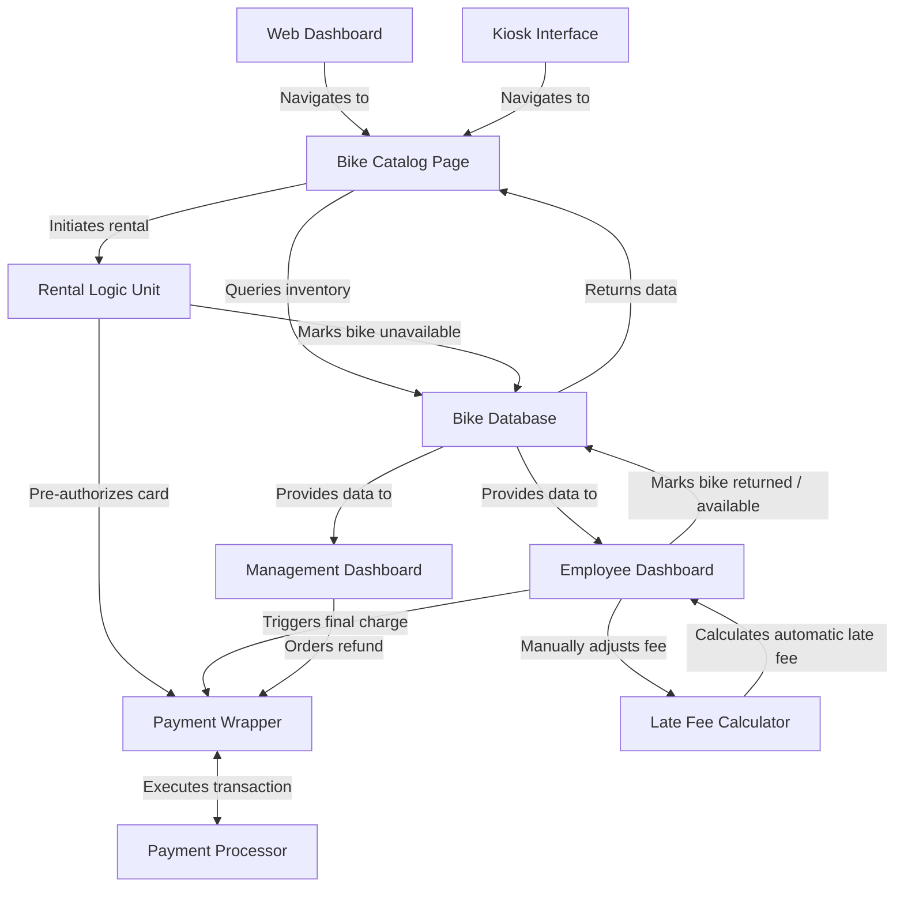
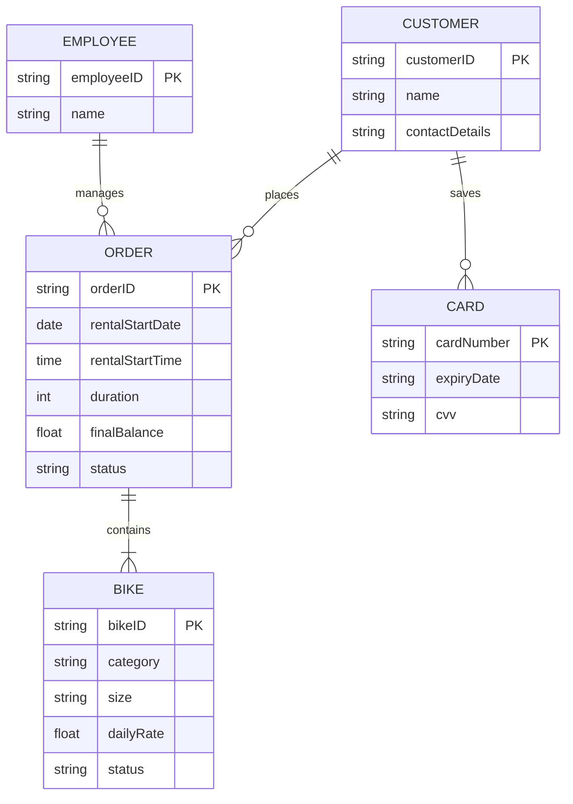
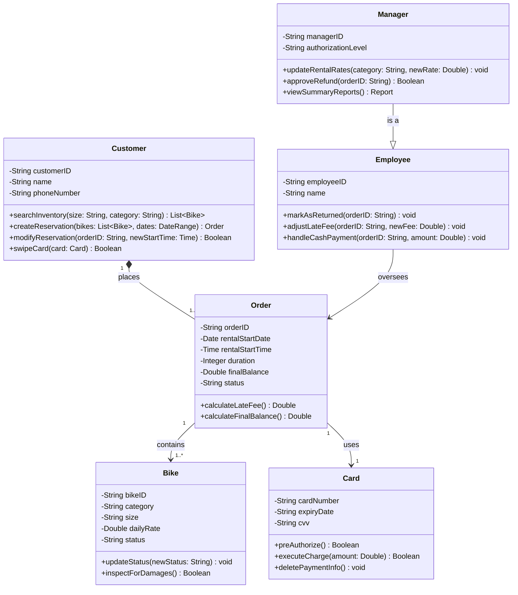

# Design Doc
## Overview
The Bend Bike shop is a store that rents bikes out to customers. They are looking to create a web-based software interface where customers can reserve bike rentals, either online (such as through a browser) or through a kiosk in the store. 

## Actors
* Customer
    * Opens inventory
    * Selects bike
    * Rents bike
    * Enters card information
    * (If on kiosk) Swipes card
* Employee
    * Opens inventory
    * Selects bike
    * Marks as returned
    * Adjusts late fees
    * Handles cash payments
* Management
    * Approves/declines refunds
    * Views summary reports
* Payment Processor (external)
    * Verifies card information
    * Conducts authorization charge
    * Charges credit or debit card
    * Approves/declines transactions

## Goals/Non-Goals
### Goals
* Display available bike inventory
* Allow bikes to be rented by customers, marking them as unavailable/occupied in a database
* Allow bikes to be added, removed, or marked unavailable manually by employees
* Allow different time intervals for rental
* Allow employees to assess late fees
* Pre-authorize users to ensure their card won't decline

### Non-goals
* The system does *not* include functionality for purchasing a bike or gear. Rentals only
* The system should *not* include advertisements within the app, or outside of the app (as that is outside of our parameters)
* The system does not need to include automatic discount systems
* The system will not require automated blacklisting of individuals. That process is manual
* Automated cancellation of future rentals due to limited stock is *not* necessary at least according to the client

## Constraints
* Payment must be charged *after* the bike is returned
* A late fee is assessed automatically when a bike isn't returned on time
* Adjustments to the late fees are assessed manually by the employee
* Rental time periods are on 4 hour increments (4 hours, 8 hours, 12 hours, etc.)
* When users pay for multiple days, they only pay for 12 hours each day (2 days is 24 hours of time paid)

## Assumptions
* The payment processor API has zero downtime
* The customer pays in USD
* Some customers may pay in cash
* The bike shop has a stable network connection for the kiosks
* The pre-authorization from the payment processor doesn't result in a nonzero charge to the customer or business

## Non-functional requirements
* Performance: The bikes page should query the database and load all available bikes in under 2 seconds under normal network conditions
* Reliability: The application should maintain an uptime of ~99%, except for the kiosks which are active when the business is open
* Security: Any payment information is promptly deleted upon the transaction being completed
* Scalability: The server must be able to handle both an online interface and multiple kiosks in the store simultaneously, without major impacts on downtime
* Fallback: If the kiosk loses connection, it should prompt the user to complete their transaction with an employee

## Components
### Diagram

### Description
| Component          |  Description                                                                                         |
|--------------------|------------------------------------------------------------------------------------------------------|
|Kiosk interface     | A specialized interface that includes touch screen capability and hardware integration (card readers)|
|Web dashboard       | An interface for users connecting on PC or phone.                                                    |
|Bike Database       | Stores information on bikes in the store's inventory                                                 |
|Bike Catalog Page   | Displays bikes from the database                                                                     |
|Rental logic unit   | Logical unit that enforces pricing constraints, and marks bikes as unavailable when rented           |
|Payment processor   | External API that processes transactions                                                             |
|Payment Wrapper     | Logical unit that determines what kind of transaction is to be made                                  |
|Employee dashboard  | Displays active rentals and allows employees to mark as returned, and make late fee adjustments      |
|Mgmt. dashboard     | Displays active and past rentals and allows management to issue refunds                              |
|Late Fee Calculator | Adjusts the amount due automatically when the bike is late                                           |

## Data Model
### ER Diagram

### Class Diagram


### Entity Schemas & Validation Rules
* **Customer**: `customerID` (UUID, PK), `name` (String, max 100 chars), `contactDetails` (Email/Phone format).
* **Bike**: `bikeID` (String, PK, e.g., "BK-ROAD-01"), `category` (Enum: `Road`, `Mountain`, `Recreational`, `Child`), `size` (Enum: `Small`, `Medium`, `Large`), `dailyRate` (Float > 0), `status` (Enum: `Available`, `Rented`, `Maintenance`).
* **Order**: `orderID` (UUID, PK), `customerID` (FK), `rentalStartDate` (ISO 8601 Date), `rentalStartTime` (ISO 8601 Time), `duration` (Integer, multiples of 4 hours), `finalBalance` (Float >= 0), `status` (Enum: `Reserved`, `Active`, `Completed`, `Cancelled`).
* **Card**: Transient schema. `cardNumber` (Masked string, max 16 digits), `expiryDate` (MM/YY), `cvv` (3-4 digits). Enforces strict zero-persistence policy via automated garbage collection after tokenization/authorization.

## Interfaces
### 1. executeCharge()
```fsharp
type OrderId            = string
type ChargeResult       = 
    | Success(transactionRef: string)
    | Declined(reason: Reason)
    | Error(code: ErrorCode)

executeCharge(txnId: Txnid, orderId: OrderId, finalCost: Cost) -> ChargeResult
```
| Field | Details |
| :--- | :--- |
| **Purpose** |  Charges the customers' card after the bike has been returned |
| **Requires** | Bike must be marked as returned. The orderId must exist. The cost must be more than zero and reflect the cost/adjustments. |
| **Outcomes** | *Success*: The transaction went through |
|              | *Declined*: The transaction was rejected by the processor, returning a reason |
|              | *Error*: The transaction encountered an error and returns an error code |
| **Guarantees** | No data storage of card info. Any data is purged once the transaction concludes, no matter the outcome |
| **Notes** | This function fulfills the design constraint that the payment occurs *after* the bike is returned |

### 2. createReservation()
```fsharp
type BikeId             = string
type DateRange          = {startDate: string; endDate: string}
type ReservationResult =
    | Valid(orderId: OrderId)
    | Invalid(reason: Reason)

createReservation(rId: RID, customerId: string, bikeId: BikeID, dates: DateRange) -> ReservationResult
```
| Field | Details |
| :--- | :--- |
| **Purpose** |  Creates a new reservation in the system |
| **Requires** | The bike must be available to be rented for the range of dates. The customerId must be registered in the system. |
| **Outcomes** | *Valid*: The order was created and will appear in the system |
|              | *Invalid*: The order was not created and will output a reason |
| **Guarantees** | No data storage of card info. Any data is purged once the transaction concludes, no matter the outcome |
| **Notes** | This function fulfills the design constraint that the payment occurs *after* the bike is returned |

### 3. searchInventory()
```fsharp
type Category           = string
type Size               = string
type SearchResult       = 
    | Found(bikes: BikeId list)
    | Empty(reason: string)

searchInventory(category: Category, size: Size, dates: DateRangee) -> SearchResult
```
| Field | Details |
| :--- | :--- |
| **Purpose** | Queries the bike database for available inventory matching specified size and category criteria. |
| **Requires** | Valid category and size parameters, along with a valid rental `DateRange`. |
| **Outcomes** | *Found*: Returns a list of available bike IDs matching the filters.<br>*Empty*: No bikes match the filters or inventory is fully booked. |
| **Guarantees** | Read-only operation; no database state is modified during the search. |
| **Notes** | Powers the catalog page for both online users and in-store kiosks. |

---

### 4. markAsReturned()
```fsharp
type ReturnResult       = 
    | Success(orderId: OrderId)
    | Error(code: ErrorCode)

markAsReturned(orderId: OrderId) -> ReturnResult
```
| Field | Details |
| :--- | :--- |
| **Purpose** | Marks a rented bike as returned in the system and updates its inventory status. |
| **Requires** | The `orderId` must exist and be tied to an active rental. |
| **Outcomes** | *Success*: Bike status is updated back to available and final balance calculation is triggered.<br>*Error*: The order ID is invalid or already closed. |
| **Guarantees** | Atomic status update ensures the bike becomes instantly available for future bookings. |
| **Notes** | Executed by employees on the employee dashboard when a customer returns a bike. |

---

### 5. adjustLateFee()
```fsharp
type AdjustmentResult   = 
    | Updated(newCost: Cost)
    | Invalid(reason: Reason)

adjustLateFee(orderId: OrderIDd, adjustedCost: Cost) -> AdjustmentResult
```
| Field | Details |
| :--- | :--- |
| **Purpose** | Allows an employee to manually modify an automatically calculated late fee. |
| **Requires** | The `orderId` must exist, and the bike must be marked as returned past its scheduled window. |
| **Outcomes** | *Updated*: The late fee is successfully overridden with the new cost.<br>*Invalid*: The adjustment violates system constraints or order is missing. |
| **Guarantees** | Maintains a record of employee intervention for audit tracking. |
| **Notes** | Satisfies the employee scenario for manually reducing late fees when customers call ahead. |

---

### 6. updateRentalRates()
```fsharp
type ManagerId          = string
type RateResult         = 
    | Saved(category: Category)
    | Unauthorized(reason: Reason)

updateRentalRates(managerId: ManagerID, category: Category, newRate: Cost) -> RateResult
```
| Field | Details |
| :--- | :--- |
| **Purpose** | Updates daily rental rates by bike category ahead of upcoming holiday weekends or peak times. |
| **Requires** | The `managerId` must have proper administrative privileges in the system. |
| **Outcomes** | *Saved*: New rates are stored and immediately reflected across booking portals.<br>*Unauthorized*: The user lacks the management authorization level required. |
| **Guarantees** | Rate updates apply strictly to future bookings and do not disrupt active or past orders. |
| **Notes** | Used by the general manager via the admin portal for rate management settings. |

## Invariants
* **Zero-Persistence Payment Security**: Payment details, such as account numbers or CVVs, must never persist in long-term storage or application logs to maintain PCI-DSS compliance.
* **Exclusive Bike Assignment**: Any individual bike instance (`bikeID`) can only be assigned to a maximum of one active or reserved order at any given time.
* **Post-Return Charging Rule**: Financial charges via `executeCharge()` may not be initiated until the bike has been formally marked as returned by an authorized employee (`markAsReturned`).
* **Privileged Refunds**: Full or partial financial refunds must be executed exclusively by management-level personnel credentials.
* **Rental Increment Alignment**: All order durations must strictly adhere to 4-hour slot increments, with multi-day totals normalized to 12 billable hours per day.

## Failure Modes
| ID | Failure | Detection | Response | Impact | Notification |
| :--: | :--: | :--: | :--: | :--: | :--: |
|FM-NETWORK-DISCONNECT | The kiosk loses its network connection during a transaction | Connection timeout | The system prompts the user to complete their transaction with an employee | Consumes staff time, produces friction for the customer | A prompt appears on the user and notifcations appear on the employee and management dashboards|
|FM-PAYMENT-TIMEOUT | The payment processor experiences an outage, or the kiosk/web portal is unable to connect | Connection timeout or payment wrapper returns an error | System aborts the transaction immediately and all payment data is wiped | User may be erroneously charged, rental payment may be delayed | An error message is displayed and management is notified |
|FM-RESERVATION-CONFLICT | Two users on kiosks or the web portal attempt to reserve the same bike, and click "accept" before the page refreshes | The program detects a violation in the constraints of the bike database | The system accepts the first transaction and rejects the second one | Additional friction for the second customer | The second user is notified that the bike is no longer available | 
|FM-CARDSWIPE-MALF | The card swiper on the kiosk fails to read the user's credit card | Card swiper returns failed | The kiosk informs the user that the card swipe failed and instructs them to speak to an employee | Additional friction for user | The user is prompted and a notification appears on the dashboard |

---

## Summary of Changes
* **Data Model Expansion**: Added explicit entity validation rules and format constraints for `Customer`, `Bike`, `Order`, and `Card` structures, alongside existing ER and class diagrams.
* **Invariants Section**: Defined 5 formal system-wide guarantees (Zero-Persistence Payment Security, Exclusive Bike Assignment, Post-Return Charging Rule, Privileged Refunds, and Rental Increment Alignment).
* **Failure Modes Enhancement**: Structured error states, system detection triggers, fallback responses, impact levels, and notification workflows in a detailed implementation matrix.