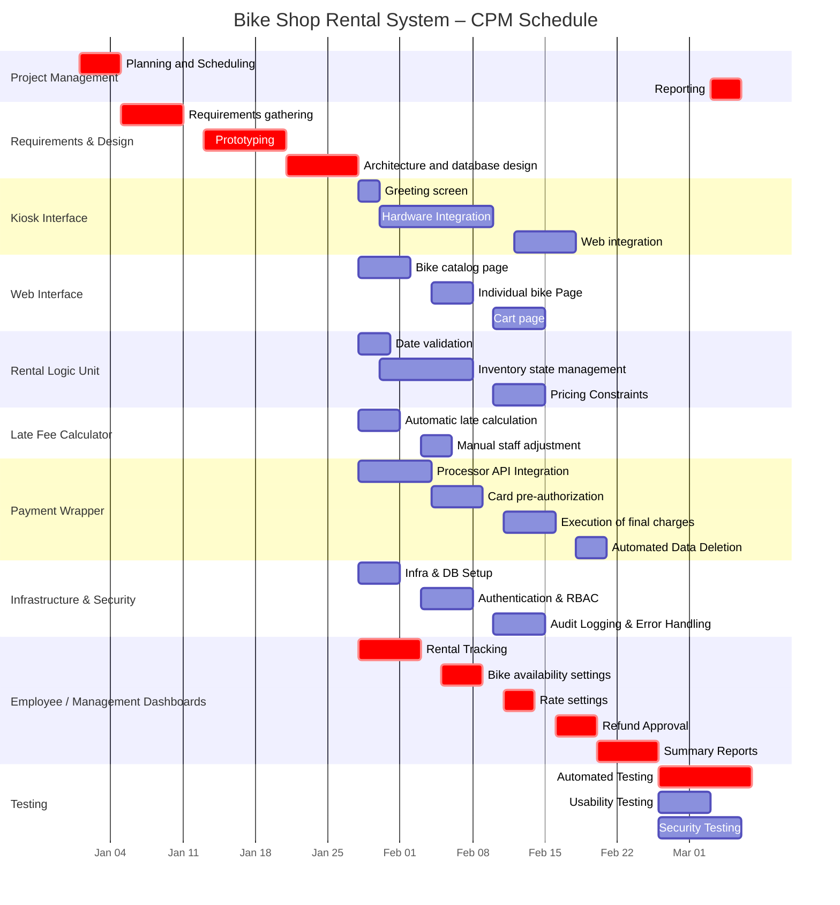

# Estimation
### WBS Tree
* Bend Bike Shop Rental System
    * Project Management
        * Planning and Scheduling (2, 4, 8)
        * Reporting (1, 3, 6)
    * Requirements and Design 
        * Requirements gathering (3, 6 12)
        * Prototyping (4, 8, 15)
        * Architecture and database design (3, 7, 14)
    * Kiosk Interface
        * Greeting screen (1, 2, 4)
        * Hardware Integration (5, 10 20)
        * Web integration(3, 6, 12)
    * Web Interface
        * Bike catalog page (2, 5, 10)
        * Individual bike Page (2, 4, 8)
        * Cart page (2, 5, 9)
    * Rental Logic Unit
        * Date validation (1, 3, 6)
        * Inventory state management (4, 8, 16)
        * Pricing Constraints (2, 5, 10)
    * Late Fee Calculator
        * Automatic late calculation (2, 4, 8)
        * Manual staff adjustment (1, 3, 6)
    * Payment Wrapper
        * Processor API Integration (3, 7, 14)
        * Card pre-authorization (2, 5, 10)
        * Execution of final, adjusted charges (2, 5, 10)
        * Automated Data Deletion (1, 3, 7)
    * Employee/Management Dashboards
        * Rental Tracking (3, 6, 12)
        * Bike availability settings (2, 4, 8)
        * Rate settings (1, 3, 6)
        * Refund Approval (2, 4, 8)
        * Summary Reports (3, 6, 12)
    * Testing
        * Automated Testing (e.g. github actions) (4, 8, 16)
        * Usability Testing (2, 5, 10)
        * Security Testing (3, 7, 10)
### Monte Carlo Simulation
p90 = ~ 78.2 days 
Assuming that the major development tasks run in parallel.

# Scheduling
### CPM Table
| TaskID  | Task                                      | Duration | Dependencies                  | ES     | EF     | LS     | LF     | Slack  |
|---------|-------------------------------------------|----------|-------------------------------|--------|--------|--------|--------|--------|
| PM1     | Planning and Scheduling                   | 4.333    | —                             | 0  | 4.33  | 0  | 4.333  | 0  |
| RD1     | Requirements gathering                    | 6.500    | PM1                           | 4.33  | 10.83 | 4.33  | 10.83 | 0  |
| RD2     | Prototyping                               | 8.500    | RD1                           | 10.83 | 19.33 | 10.83 | 19.33 | 0  |
| RD3     | Architecture and database design          | 7.500    | RD2                           | 19.33 | 26.83 | 19.33 | 26.83 | 0  |
| KI1     | Greeting screen                           | 2.167    | RD3                           | 26.83 | 29.00 | 32.16 | 34.33 | 5.33  |
| KI2     | Hardware Integration                      | 10.833   | KI1                           | 29 | 39.83 | 34.33 | 45.16 | 5.33  |
| KI3     | Web integration                           | 6.500    | KI2                           | 39.83 | 46.33 | 45.16 | 51.66 | 5.33  |
| WI1     | Bike catalog page                         | 5.333    | RD3                           | 26.83 | 32.16 | 36.83 | 42.16 | 10 |
| WI2     | Individual bike Page                      | 4.333    | WI1                           | 32.16 | 36.50 | 42.16 | 46.50 | 10 |
| WI3     | Cart page                                 | 5.167    | WI2                           | 36.50 | 41.66 | 46.50 | 51.66 | 10 |
| RL1     | Date validation                           | 3.167    | RD3                           | 26.83 | 30.00 | 34.50 | 37.66 | 7.66  |
| RL2     | Inventory state management                | 8.667    | RL1                           | 30 | 38.66 | 37.66 | 46.33 | 7.66  |
| RL3     | Pricing Constraints                       | 5.333    | RL2                           | 38.66 | 44.0 | 46.33 | 51.66 | 7.66  |
| LF1     | Automatic late calculation                | 4.333    | RD3                           | 26.83 | 31.16 | 44.16 | 48.50 | 17.33 |
| LF2     | Manual staff adjustment                   | 3.167    | LF1                           | 31.16 | 34.33 | 48.50 | 51.66 | 17.33 |
| PW1     | Processor API Integration                 | 7.500    | RD3                           | 26.83 | 34.33 | 30.16 | 37.67 | 3.33  |
| PW2     | Card pre-authorization                    | 5.333    | PW1                           | 34.33 | 39.66 | 37.66 | 43.00 | 3.33  |
| PW3     | Execution of final, adjusted charges      | 5.333    | PW2                           | 39.66 | 45.0 | 43.00 | 48.33 | 3.33  |
| PW4     | Automated Data Deletion                   | 3.333    | PW3                           | 45 | 48.33 | 48.33 | 51.66 | 3.33  |
| ED1     | Rental Tracking                           | 6.500    | RD3                           | 26.83 | 33.33 | 26.83 | 33.33 | 0  |
| ED2     | Bike availability settings                | 4.333    | ED1                           | 33.33 | 37.66 | 33.33 | 37.66 | 0  |
| ED3     | Rate settings                             | 3.167    | ED2                           | 37.66 | 40.83 | 37.66 | 40.83 | 0  |
| ED4     | Refund Approval                           | 4.333    | ED3                           | 40.83 | 45.16 | 40.83 | 45.16 | 0  |
| ED5     | Summary Reports                           | 6.500    | ED4                           | 45.16 | 51.66 | 45.16 | 51.66 | 0  |
| T1      | Automated Testing                         | 8.667    | KI3, WI3, RL3, LF2, PW4, ED5  | 51.66 | 60.33 | 51.66 | 60.33 | 0  |
| T2      | Usability Testing                         | 5.333    | KI3, WI3, RL3, LF2, PW4, ED5  | 51.66 | 57.0 | 55.00 | 60.33 | 3.33  |
| T3      | Security Testing                          | 7.667    | KI3, WI3, RL3, LF2, PW4, ED5  | 51.66 | 59.33 | 52.66 | 60.33 | 1  |
| PM2     | Reporting                                 | 3.167    | ED5, T1, T2, T3               | 60.33 | 63.50 | 60.33 | 63.50 | 0  |
### Gantt Chart
